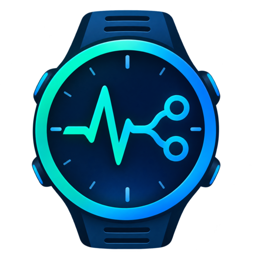

<p align="center">
  
</p>

<h1 align="center">Garmin Connect MCP</h1>

A personal, **read-only** MCP connector for the official Garmin Connect Personal API,
supporting MCP over stdio and local Streamable HTTP. Built to help explore workouts
and fitness trends—not to diagnose medical conditions.

**Status:** Implementation and synthetic local tests are available. The source is
published at [graiola/garmin-connect-mcp](https://github.com/graiola/garmin-connect-mcp).
The maintainer reported a successful local `doctor` check on November 5, 2026
(authentication and one activity read); this was not independently repeated here.
A live agent/MCP, Secure MCP Tunnel or Agensi connection remains unverified.
Never provide your Garmin API key in chat or commit it to the repository.

## Available tools

| Tool | Data returned |
|---|---|
| `garmin_list_activities` | Paginated activities, optionally filtered by date and type |
| `garmin_get_activity` | Raw activity summary and details |
| `garmin_get_activity_workouts` | Associated workouts, containing only fields actually returned by Garmin |
| `garmin_get_health_range` | Weight, steps, stress, sleep, HRV, Body Battery, and daily summaries |
| `garmin_get_day_detail` | Sleep, HRV, or heart-rate details for a day |
| `garmin_connector_status` | Capabilities, local date, and version; does **not** validate credentials |

Dates are explicit (`YYYY-MM-DD`), with `Europe/Rome` as the default time zone.
Health ranges are capped at 31 inclusive days, and activities at 50 per page.
There are no Garmin write operations, deletions, workout planning, or uploads.

**Strength-training limitation:** Garmin's official `workouts` endpoint does not
guarantee actual performed sets, edited exercise names, weights, or reps. This
connector does not decode FIT files or fabricate missing data. Compare one of your
own strength sessions against Garmin Connect before relying on it instead of a
detailed export. Loads on different machines are not automatically comparable.

## Install (Linux/macOS)

Requires Python 3.11+ and HTTPS access to Garmin. From the repository root:

```bash
python3 -m venv .venv
source .venv/bin/activate
python -m pip install -e '.[dev]'
python -m pytest -q
```

`requirements-tested.txt` records the versions used in the original local tests.
It is not a cross-platform lockfile; CI checks the declared dependency ranges.

## Configure credentials locally

```bash
garmin-connect-mcp configure
garmin-connect-mcp doctor
```

`configure` securely prompts for your **Garmin Personal API key** without echoing
it and creates two files outside the repository:

- `~/.config/garmin-connect-mcp/api-key`: your Garmin key.
- `~/.config/garmin-connect-mcp/http-token`: an independent random token for local HTTP.

Files use `0600` permissions on POSIX systems. Secret values are never printed.
`doctor` checks authentication and performs one activity read, reporting only
the outcome—not the activity data. If it fails, **do not paste the key into chat**.

Secret-manager alternatives are `GARMIN_PERSONAL_API_KEY` and
`GARMIN_PERSONAL_API_KEY_FILE` (the explicit file takes precedence).
`GARMIN_MCP_ACCESS_TOKEN` and `GARMIN_MCP_ACCESS_TOKEN_FILE` instead secure
access to the connector's local HTTP server. Do not reuse the Garmin key as the
MCP bearer token. `.env` files are not loaded automatically.

## Connect to ChatGPT

**GitHub hosts the source, not a running MCP server.** You need a machine running
the connector when you request data and a supported connection method for your
ChatGPT account.

The recommended approach is an authenticated **Secure MCP Tunnel**. Your Garmin
key stays on your own host, rather than being exposed through a public HTTP
endpoint. This requires a `tunnel_id`, an independent OpenAI runtime key, and the
appropriate account/workspace permissions; availability for your account has not
been verified.

See the complete [ChatGPT connection guide](docs/CHATGPT.md).

```bash
# After installing the official tunnel-client and creating your private tunnel:
./scripts/tunnel_stdio.sh tunnel_YOUR_ID
```

The script prompts locally for the OpenAI tunnel runtime key unless it is already
in the environment. **This is not the Garmin API key.** It then configures,
checks, and runs the tunnel in the foreground. In ChatGPT, use
**Plugins → + → Add custom MCP server → Connection: Tunnel**.

For a local MCP/Codex client, run the stdio transport directly:

```bash
/path/to/garmin-connect-mcp/.venv/bin/garmin-connect-mcp stdio
```

To test local HTTP instead:

```bash
garmin-connect-mcp http --port 8765
```

It listens **only** on `127.0.0.1` and requires the independent bearer token.
Never expose this mode through an unauthenticated public HTTP tunnel. It is not
an OAuth authorization server.

## Repository and security

The GitHub repository is currently **public**. Do not push any Garmin key,
OpenAI token, personal health data, FIT export, or captured response. The
`scripts/publish_github.sh` helper only bootstraps a **new** private repository
and intentionally refuses to overwrite an existing one; it is not used for
updates to this repository.

- Only allowlisted official Garmin endpoints are called; no scraping, password
  login, reverse-engineered sessions, cookies, or arbitrary URLs.
- Keys are exchanged for short-lived tokens when needed; tokens remain in memory.
  A `401` triggers at most one fresh exchange and retry.
- Requests have bounded timeouts, concurrency, retries, and response sizes.
- GPS coordinates and selected identifiers are filtered recursively. **This is
  not full anonymization:** activity names and free-form notes can contain
  personal information.
- The connector does not independently send data to an LLM. When you call its
  tools from ChatGPT, responses pass through the connected services and chat.
- Errors are sanitized; authorization headers and response bodies are not logged.
- The lightweight, tools-only MCP transport does not implement persistent SSE,
  OAuth, resources, prompts, or experimental tasks.
- Requests run on demand; there is no background monitoring or scraping.

Read [SECURITY.md](SECURITY.md), the [API contract](docs/API_CONTRACT.md), and
the [verification record](docs/VERIFICATION.md). This is a single-user personal
connector, not a multiuser or public health-data service.

## Free companion skill and Agensi preparation

[Garmin Connect MCP Assistant](skills/garmin-connect-mcp-assistant/SKILL.md) teaches
an agent to use these six tools with bounded reads, explicit dates, missing-data
handling and privacy safeguards. It is MIT-licensed and does not change the server.
It does not include credentials, host a connector, install one automatically, or
provide medical diagnoses or guaranteed performed strength sets.

The skill source is available now. An Agensi listing is **prepared, not submitted
or approved**. Users loading it there will still need their own configured Garmin
MCP connection in the same agent. Compatibility with specific third-party clients
must be verified by a real read; local mocked tests are not sufficient.

Build the exact six-file, text-only upload package with Python 3.11+:

```bash
python scripts/build_agensi_package.py --check
python scripts/build_agensi_package.py
```

The ZIP and SHA-256 checksum are written under `dist/agensi/`. After successful
CI, the `agensi-launch-bundle` Actions artifact also contains the upload ZIP,
existing 512 × 512 logo and prepared listing materials. Extract that outer artifact
before uploading the inner skill ZIP; do not upload the whole repository.

See the [launch guide](docs/agensi/LAUNCH.md),
[listing description](docs/agensi/LISTING.md),
[synthetic demonstration](docs/agensi/DEMO.md), and
[acceptance checklist](docs/agensi/ACCEPTANCE.md).

## Acceptance prompts after connecting

1. "Show my three latest activities without making fitness conclusions."
2. "Open activity X and show only measurements that are actually available."
3. "Compare two swims, separating moving time, elapsed time, and rest."
4. "Read my last 14 days of weigh-ins, preserve original units, and flag gaps."

Verify at least one activity against Garmin Connect. Passing local mocked tests
does **not** prove real data accuracy or compatibility with your ChatGPT account.
